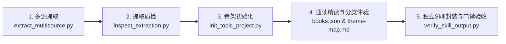

# hs-books4topic-to-skill

> [English](README_EN.md) | **中文**

**多书转多主题独立 Skills 生产母机（Agent Skill）**

面向多源专业书籍的知识工程母机。用户指定书籍目录后，通读其中多本书，按第一性原理聚类并融合方法论；先向用户报告确认的主题数量与分组理由，再为每个主题生成一个可单独安装使用的生产级独立 Skill（**最终主题数 K 必须严格等于独立 Skill 数 K**），并自动出具全量覆盖审计报告与质量门禁测试集。

---

## 🌟 核心理念与设计原则

- **一主题一独立 Skill（K = K）**：坚决拒绝粗暴的单一大路由 Skill 或敷衍的章节摘要。只要划定 K 个主题，就必须在输出目录生成 K 个自包含的独立 Skill，每个均具备专属的 `SKILL.md`、方法卡库和自动化测试集。
- **环境严格物理隔离**：提取缓存、审计文档和生成的 Skills 全部输出在母机与书籍目录之外的外部运行目录，保持代码库纯粹。
- **事实为准与去伪存真仲裁**：每一条可执行规则必须能溯源至原书具体章节，拒绝无据捏造；多书冲突时依据适用边界进行理性仲裁，不搞强行拼接与无脑平均。
- **自动化门禁严密校验**：内置 `verify_skill_output.py` 工具，对书籍映射表、执行合同、方法卡字数和四类测试用例（`should_trigger`、`should_not_trigger`、`neighbor`、`output`）实行全自动化验收。

---

## 🛠️ 五步标准工作流



1. **多源格式提取**：运行 `extract_multisource.py` 自动化解析 EPUB、PDF、Markdown 与文本，生成分片索引；
2. **提取质量审计**：运行 `inspect_extraction.py` 检查分片标题唯一率与阅读连续性；
3. **项目骨架构建**：运行 `init_topic_project.py` 初始化 `corpus-audit/` 审计骨架与清单；
4. **精读解构与用户报告**：撰写每本书的 `overview.md` 与 `coverage.md`，确立 `theme-map.md`，在正式写代码前向用户报告最终主题划分方案；
5. **独立封装与门禁校验**：为每个主题编写完整 Skill 包，并运行 `verify_skill_output.py` 完成 100% 结构化门禁验收。

---

## 📂 输出工程合同规范

```text
<外部运行目录>/
├── corpus-audit/
│   ├── books.json                 # 每本书的主要主题归属、阅读状态与源索引
│   ├── theme-map.md               # 主题分类边界、分组与拆分/合并理由
│   ├── coverage.md                # 全库核心方法去向与完整覆盖矩阵
│   └── books/                     # 每本书的逐书档案 (b01-overview.md / b01-coverage.md)
└── skills/
    ├── <theme-a>/
    │   ├── SKILL.md               # 可独立触发调用的标准入口
    │   ├── references/
    │   │   ├── synthesis.md       # 跨书多源取舍与冲突仲裁记录
    │   │   ├── sources.md         # 逐条原书定位证据链
    │   │   └── methods/           # 可执行方法卡 (.md)
    │   └── evals/
    │       ├── cases.json         # 四类测试用例 (触发/反例/近邻/输出合同)
    │       └── results.json       # 自动化测试结果记录
    └── <theme-b>/SKILL.md
```

---

## 🚀 安装与使用

克隆或复制本目录到您的 AI Agent 技能库中：

```bash
git clone https://github.com/your-username/hs-books4topic-to-skill.git
```

### 使用方式
直接在 AI 聊天对话中发送：
> “请使用 `/hs-books4topic-to-skill` 处理 `/path/to/books` 下的书籍，通读其中多本书，按主题分类并融合方法论，先报告主题数量，再为每个主题生成一个独立 Skill。”

---

## 📄 License

Private / MIT (详见仓库根目录许可证).
