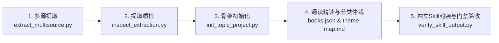

# hs-books4topic-to-skill

> [English](README_EN.md) | **中文**

**多书转多主题独立 Skills 生产母机（Agent Skill）**

面向多源专业书籍的知识工程母机。用户指定书籍目录后，通读其中多本书，按第一性原理聚类并融合方法论；先向用户报告确认的主题数量与分组理由，再为每个主题生成一个可单独安装使用的生产级独立 Skill（**最终主题数 K 必须严格等于独立 Skill 数 K**），并自动出具全量覆盖审计报告与质量门禁测试集。

---

## 💡 致敬开拓者与演进意义

### 1. 向 [Cangjie Skill (仓颉)](https://github.com/kangarooking/cangjie-skill) 致敬

在 AI 知识工程与技能提炼领域，[kangarooking/cangjie-skill](https://github.com/kangarooking/cangjie-skill)（仓颉造技能）开辟了令人尊敬的先河。仓颉提出了极为优雅的 **RIA-TV++** 知识萃取方法论与确定性交付流水线，让开发者和学者能够“读完一本书、看完一段视频，便能带着一套可调用的 AI Skill 离开”。它在单源媒体的方法论提取、能力卡片解耦与自动化工具链上做出了卓越的原创性贡献。

---

### 2. 为什么需要从“单书萃取”进化到“多书主题合成”？

仓颉完美解决了**“单本著作/单一媒体从 0 到 1 转化为 Skill”**的问题。然而，当我们将视角投向真实的工业化复杂业务（如影视工业、金融量化、医学诊断、航空航天等）时，往往会遭遇传统单书萃取模式的四大天然瓶颈：

```text
┌────────────────────────────────────────────────────────────────────────────────────────┐
│                        传统“单书做 Skill”模式在复杂工业领域的局限                      │
├────────────────────────┬───────────────────────────────────────────────────────────────┤
│ 1. 知识体系碎片化与割裂│ 复杂领域从来不是一本书能讲透的。如影视制作涵盖编剧、导演、摄影、│
│    (Fragmentation)     │ 服化、剪辑、声音等十多个环节。若按 25 本书单本提炼，将得到 25 个│
│                        │ 互不相通的孤立 Skill，形成严重的“知识孤岛”与“流水线流程断层”。 │
├────────────────────────┼───────────────────────────────────────────────────────────────┤
│ 2. 术语冲突与逻辑打架  │ 不同作者对同一概念定义各异（如 McKee 的对抗反转 vs Snyder 的 15│
│    (Terminology Clash) │ 节拍 vs Egri 的前提三维性格）。单书技能各自为政，导致 Agent 在│
│                        │ 执行综合创作时面临方法论冲突，无所适从、左右互搏。            │
├────────────────────────┼───────────────────────────────────────────────────────────────┤
│ 3. 知识严重冗余与争抢  │ 同一领域的多本经典常有大量重叠阐述。按书做技能将导致大量重复的│
│    (Context Bloat)     │ 规则卡片，严重膨胀 Agent 上下文，并引起近邻技能的触发竞争。   │
├────────────────────────┼───────────────────────────────────────────────────────────────┤
│ 4. 缺乏全流程交付闭环  │ 单书方法往往止步于作者个人的局部经验，难以直接组装为可支撑复杂│
│    (Pipeline Gap)      │ 工程状态机（如从剧本到 3D 机位再到底模原生代码）的工业级流水线。│
└────────────────────────┴───────────────────────────────────────────────────────────────┘
```

---

### 3. `hs-books4topic-to-skill` 的核心使命与突破

如果说 **Cangjie Skill 是精准的“单字点石成金”**，那么 **`hs-books4topic-to-skill` 则是统领宏观体系的“跨源活字编撰器”**。它专注于解决**“数十本同领域专著如何融会贯通、去伪存真、合成为一套生产级技能生态”**的命题：

- **以工业任务为主题（Topic）聚类，而非以书籍名称聚类**：不问“这本书能产出什么”，而问“该行业的核心任务需要哪些互补能力”，将多本书籍作为同一个主题下的论据与构件进行正交合成。
- **第一性原理跨源去伪存真仲裁（Cross-Source Truth Arbitration）**：深入辨析不同作者的互补点与分歧点，明确定论、舍弃理由与适用条件，剔除经验主义套话，输出严密的工业级执行合同。
- **K 个主题严格对应 K 个独立生产级 Skill（K = K）**：坚决拒绝粗暴臃肿的“总路由大杂烩”，每个主题 Skill 均自包含 `SKILL.md`、方法卡库、原书证据链与四类测试集，既能单兵作战，又能被主控大脑协同调度。
- **100% 覆盖率审计与严格门禁（Audit Gate）**：内置 `verify_skill_output.py`，从底层分片校验到测试用例验收，杜绝“未读先写”、“虚假覆盖”与“幻觉总结”。

#### 核心对比一览

| 维度 | Cangjie Skill (仓颉) | hs-books4topic-to-skill |
| :--- | :--- | :--- |
| **核心范式** | 单源萃取 (Single Source Extraction) | **多源主题级工业合成 (Multi-Source Thematic Synthesis)** |
| **处理输入** | 单本书、单个长视频、单集播客 | **数十本经典专著构成的专业领域书库 (Corpus)** |
| **知识组织** | 按书籍/媒体内容组织 Capability Pack | **按行业生产工种与真实任务聚类为 K 个独立主题** |
| **冲突处理** | 忠于并呈现单作者的方法视角 | **跨书对比、去伪存真、明确适用边界与舍弃理由** |
| **产出形态** | 单个 Skill 或带 Router 的紧凑 Pack | **K 个独立自包含、可单独发布的专业主题 Skill (K=K)** |
| **审计机制** | 内容寻址预处理、代码差异与事务快照 | **全库阅读覆盖矩阵 + 独立门禁测试集 (`verify_skill_output.py`)** |
| **最适场景** | 快速吸收单一著作精华、个人知识资产化 | **为大型工业联合体（如 `hs-dramaskill` 虚拟制片厂）打造全套专业技能底座** |

---

## 🌟 核心理念与设计原则

- **一主题一独立 Skill（K = K）**：坚决拒绝粗暴的单一大路由 Skill 或敷衍的章节摘要。只要划定 K 个主题，就必须在输出目录生成 K 个自包含的独立 Skill，每个均具备专属的 `SKILL.md`、方法卡库和自动化测试集。
- **环境严格物理隔离**：提取缓存、审计文档和生成的 Skills 全部输出在母机与书籍目录之外的外部运行目录，保持代码库纯粹。
- **事实为准与去伪存真仲裁**：每一条可执行规则必须能溯源至原书具体章节，拒绝无据捏造；多书冲突时依据适用边界进行理性仲裁，不搞强行拼接与无脑平均。
- **自动化门禁严密校验**：内置 `verify_skill_output.py` 工具，对书籍映射表、执行合同、方法卡字数和四类测试用例（`should_trigger`、`should_not_trigger`、`neighbor`、`output`）实行全自动化验收。

---

## 🛠️ 五步标准工作流



1. **多源格式提取**：运行 `extract_multisource.py` 自动化解析 EPUB、PDF、Markdown 与文本，生成分片索引；
2. **提取质量审计**：运行 `inspect_extraction.py` 检查分片标题唯一率与阅读连续性；
3. **项目骨架构建**：运行 `init_topic_project.py` 初始化 `corpus-audit/` 审计骨架与清单；
4. **精读解构与用户报告**：撰写每本书的 `overview.md` 与 `coverage.md`，确立 `theme-map.md`，在正式写代码前向用户报告最终主题划分方案；
5. **独立封装与门禁校验**：为每个主题编写完整 Skill 包，并运行 `verify_skill_output.py` 完成 100% 结构化门禁验收。

---

## 📂 输出工程合同规范

```text
<外部运行目录>/
├── corpus-audit/
│   ├── books.json                 # 每本书的主要主题归属、阅读状态与源索引
│   ├── theme-map.md               # 主题分类边界、分组与拆分/合并理由
│   ├── coverage.md                # 全库核心方法去向与完整覆盖矩阵
│   └── books/                     # 每本书的逐书档案 (b01-overview.md / b01-coverage.md)
└── skills/
    ├── <theme-a>/
    │   ├── SKILL.md               # 可独立触发调用的标准入口
    │   ├── references/
    │   │   ├── synthesis.md       # 跨书多源取舍与冲突仲裁记录
    │   │   ├── sources.md         # 逐条原书定位证据链
    │   │   └── methods/           # 可执行方法卡 (.md)
    │   └── evals/
    │       ├── cases.json         # 四类测试用例 (触发/反例/近邻/输出合同)
    │       └── results.json       # 自动化测试结果记录
    └── <theme-b>/SKILL.md
```

---

## 🚀 安装与使用

克隆或复制本目录到您的 AI Agent 技能库中：

```bash
git clone https://github.com/your-username/hs-books4topic-to-skill.git
```

### 使用方式
直接在 AI 聊天对话中发送：
> “请使用 `/hs-books4topic-to-skill` 处理 `/path/to/books` 下的书籍，通读其中多本书，按主题分类并融合方法论，先报告主题数量，再为每个主题生成一个独立 Skill。”

---

## 📄 License

Private / MIT (详见仓库根目录许可证).
