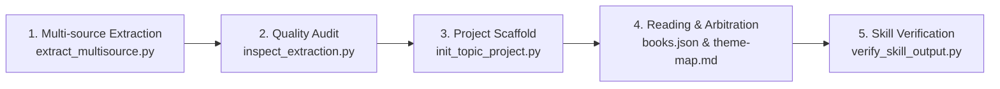

# hs-books4topic-to-skill

> **English** | [中文](README.md)

**Autonomous Multi-Book Knowledge Synthesizer & Standalone Skill Factory (Agent Skill)**

An industrial-grade knowledge engineering engine that reads a corpus of domain books, performs thematic clustering and source truth arbitration, and autonomously compiles **K standalone, production-ready AI Skills** (where **K topics strictly equal K independent Skills**). It replaces naive book summaries, single giant routing skills, and raw RAG retrieval with verified, actionable, and self-contained Agent Skills.

---

## 💡 Homage to Pioneers & Evolutionary Mission

### 1. Homage to [Cangjie Skill (仓颉)](https://github.com/kangarooking/cangjie-skill)

In the emerging field of AI skill extraction and knowledge engineering, [kangarooking/cangjie-skill](https://github.com/kangarooking/cangjie-skill) established an admirable milestone. Cangjie introduced the elegant **RIA-TV++** methodology and deterministic delivery pipelines, empowering developers and scholars to "finish reading a book or listening to a podcast—and leave with a callable AI Skill." It made groundbreaking contributions to single-source methodology extraction, capability card decoupling, and automated CLI toolchains.

---

### 2. Why Evolve from "Single-Book Extraction" to "Multi-Book Thematic Synthesis"?

While Cangjie masterfully solves the problem of **converting a single work or medium into an executable Skill from 0 to 1**, real-world industrial domains (such as cinema virtual production, quantitative finance, clinical medicine, aerospace, and legal architecture) present four inherent bottlenecks when using the single-book extraction paradigm:

```text
┌──────────────────────────────────────────────────────────────────────────────────────────────────┐
│              Limitations of the "Single-Book Skill" Paradigm in Complex Engineering              │
├────────────────────────┬─────────────────────────────────────────────────────────────────────────┤
│ 1. Knowledge           │ Real disciplines cannot be encapsulated in a single book. Cinema, for   │
│    Fragmentation &     │ instance, spans screenwriting, directing, camera optics, wardrobe, cuts,│
│    Process Gaps        │ and sound. Converting 25 books individually creates 25 disconnected     │
│                        │ "knowledge silos" with severe pipeline handoff fractures.               │
├────────────────────────┼─────────────────────────────────────────────────────────────────────────┤
│ 2. Terminology Clash & │ Different authors define similar concepts using divergent frameworks    │
│    Unarbitrated Dogma  │ (e.g., McKee's value reversal vs. Snyder's 15 beats vs. Egri's premise).│
│                        │ Independent single-book skills cause conflicting logic and model fights.│
├────────────────────────┼─────────────────────────────────────────────────────────────────────────┤
│ 3. Severe Redundancy & │ Canonical books within the same domain heavily overlap in basic theory. │
│    Context Bloat       │ Extracting per-book generates bloated duplicate cards, wasting context  │
│                        │ windows and triggering mutual skill routing competition.                │
├────────────────────────┼─────────────────────────────────────────────────────────────────────────┤
│ 4. Lack of Pipeline    │ Single-book methodologies represent isolated personal wisdom, rarely    │
│    State Machines      │ assembling directly into a full-pipeline engineering state machine.     │
└────────────────────────┴─────────────────────────────────────────────────────────────────────────┘
```

---

### 3. Core Mission of `hs-books4topic-to-skill`

If **Cangjie Skill represents precise "monosyllabic gold-smithing"**, **`hs-books4topic-to-skill` acts as a "multi-source movable-type synthesizer"**. It is built to resolve the challenge of **"how to arbitrate, unify, and synthesize dozens of domain classics into a production-grade skill ecosystem"**:

- **Task-Centric Thematic Clustering**: Instead of asking *"What can this book produce?"*, it asks *"What capabilities does this industrial workflow require?"*, clustering multiple books into orthogonal thematic skills.
- **First-Principles Cross-Source Truth Arbitration**: Scrutinizes agreements, trade-offs, and boundary conditions across authors. Prunes dogmatic advice and redundant jargon to compile strict, verifiable execution contracts.
- **K Topics = K Independent Production Skills (K = K)**: Rejects bloated single-router mega-prompts. Each topic yields a self-contained Skill with its own `SKILL.md`, method cards, source citations, and evaluation cases (`evals/`).
- **100% Audit Coverage Gates**: Powered by `verify_skill_output.py`, ensuring full-corpus extraction is verifiable, free from hallucinations, and structurally compliant.

#### Comparison at a Glance

| Dimension | Cangjie Skill (仓颉) | hs-books4topic-to-skill |
| :--- | :--- | :--- |
| **Core Paradigm** | Single-Source Extraction | **Multi-Source Thematic Industrial Synthesis** |
| **Input Scope** | Single book, single video, or podcast episode | **Full domain library (Corpus) containing dozens of books** |
| **Knowledge Organization** | Capability Packs organized by source work | **K orthogonal themes mapped to industrial craft workflows** |
| **Conflict Resolution** | Faithfully reflects the individual author's view | **Cross-source truth arbitration, pruning, and trade-off records** |
| **Output Deliverable** | Single Skill or Router-based compact Pack | **K standalone, production-ready, publishable Skills (K=K)** |
| **Audit Mechanism** | Content-addressed preprocessing, diffs, snapshots | **Full-corpus reading coverage matrix + verification test suites** |
| **Best Suited For** | Fast distillation of single works / personal assets | **Forging the complete skill foundation for virtual studios & suites** |

---

## 🌟 Core Philosophy & Guiding Principles

- **1 Topic = 1 Standalone Skill**: Rejects giant monolithic prompts and superficial chapter summaries. If K topics are identified, K self-contained Skill packages are produced, each with its own `SKILL.md`, execution contracts, reference methods, and evaluation suites.
- **Strict Environment Isolation**: All extracted chunk caches, audit ledgers, and generated Skills are written to an external workspace outside the generator engine and input book folders.
- **Rigorous Source Truth & Arbitration**: Every actionable rule must trace back to verifiable book sections. Competing author methodologies are arbitrated by applicability criteria rather than arbitrary averaging.
- **Automated Structural & Evaluation Gates**: Built-in verification scripts (`verify_skill_output.py`) validate JSON ledgers, markdown contracts, method cards, and four evaluation case types (`should_trigger`, `should_not_trigger`, `neighbor`, `output`).

---

## 🛠️ The 5-Step Workflow



1. **Extraction**: `scripts/extract_multisource.py --sources <dir> --output-dir <out>/extracted` parses EPUB, PDF, and Markdown files into indexed chunks.
2. **Quality Inspection**: `scripts/inspect_extraction.py` audits chunk titles, character counts, and reading spine integrity.
3. **Scaffold Initialization**: `scripts/init_topic_project.py` establishes the `corpus-audit/` ledger and book mapping.
4. **Thematic Reading & Synthesis**: The Agent reads key structures, writes per-book `overview.md` and `coverage.md`, establishes `theme-map.md`, and reports the K finalized topics to the user before writing code.
5. **Skill Packaging & Gate Check**: Writes K Skills under `skills/<slug>/` and validates structural compliance via `scripts/verify_skill_output.py`.

---

## 📂 Output Package Contract

```text
<output-root>/
├── corpus-audit/
│   ├── books.json                 # Primary theme, reading status, and book indexes
│   ├── theme-map.md               # Thematic boundaries and clustering rationale
│   ├── coverage.md                # Full-corpus methodology mapping matrix
│   └── books/                     # Per-book overview.md & coverage.md (B01 to Bxx)
└── skills/
    ├── <theme-a>/
    │   ├── SKILL.md               # Standalone entry point (Triggers, Inputs, Contract)
    │   ├── references/
    │   │   ├── synthesis.md       # Multi-source arbitration & trade-offs
    │   │   ├── sources.md         # Verifiable source citations
    │   │   └── methods/           # Production method cards (.md)
    │   └── evals/
    │       ├── cases.json         # 4-tier test cases (trigger, negative, neighbor, output)
    │       └── results.json       # Automated gate run results
    └── <theme-b>/SKILL.md
```

---

## 🚀 Installation & Usage

Clone or copy into your Agent's skills directory:

```bash
git clone https://github.com/your-username/hs-books4topic-to-skill.git
```

### Prompting Example
Direct your Agent in plain language:
> *"Use `/hs-books4topic-to-skill` to process all cinema and screenwriting books in `/path/to/books`. Read each book, audit their methodologies, report the finalized topics, and compile a standalone Skill for each topic."*

---

## 📄 License

Private / MIT (See repository license).
