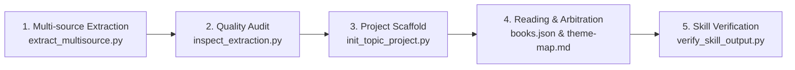

# hs-books4topic-to-skill

> **English** | [中文](README.md)

**Autonomous Multi-Book Knowledge Synthesizer & Standalone Skill Factory (Agent Skill)**

An industrial-grade knowledge engineering engine that reads a corpus of domain books, performs thematic clustering and source truth arbitration, and autonomously compiles **K standalone, production-ready AI Skills** (where **K topics strictly equal K independent Skills**). It replaces naive book summaries, single giant routing skills, and raw RAG retrieval with verified, actionable, and self-contained Agent Skills.

---

## 🌟 Core Philosophy & Guiding Principles

- **1 Topic = 1 Standalone Skill**: Rejects giant monolithic prompts and superficial chapter summaries. If K topics are identified, K self-contained Skill packages are produced, each with its own `SKILL.md`, execution contracts, reference methods, and evaluation suites.
- **Strict Environment Isolation**: All extracted chunk caches, audit ledgers, and generated Skills are written to an external workspace outside the generator engine and input book folders.
- **Rigorous Source Truth & Arbitration**: Every actionable rule must trace back to verifiable book sections. Competing author methodologies are arbitrated by applicability criteria rather than arbitrary averaging.
- **Automated Structural & Evaluation Gates**: Built-in verification scripts (`verify_skill_output.py`) validate JSON ledgers, markdown contracts, method cards, and four evaluation case types (`should_trigger`, `should_not_trigger`, `neighbor`, `output`).

---

## 🛠️ The 5-Step Workflow



1. **Extraction**: `scripts/extract_multisource.py --sources <dir> --output-dir <out>/extracted` parses EPUB, PDF, and Markdown files into indexed chunks.
2. **Quality Inspection**: `scripts/inspect_extraction.py` audits chunk titles, character counts, and reading spine integrity.
3. **Scaffold Initialization**: `scripts/init_topic_project.py` establishes the `corpus-audit/` ledger and book mapping.
4. **Thematic Reading & Synthesis**: The Agent reads key structures, writes per-book `overview.md` and `coverage.md`, establishes `theme-map.md`, and reports the K finalized topics to the user before writing code.
5. **Skill Packaging & Gate Check**: Writes K Skills under `skills/<slug>/` and validates structural compliance via `scripts/verify_skill_output.py`.

---

## 📂 Output Package Contract

```text
<output-root>/
├── corpus-audit/
│   ├── books.json                 # Primary theme, reading status, and book indexes
│   ├── theme-map.md               # Thematic boundaries and clustering rationale
│   ├── coverage.md                # Full-corpus methodology mapping matrix
│   └── books/                     # Per-book overview.md & coverage.md (B01 to Bxx)
└── skills/
    ├── <theme-a>/
    │   ├── SKILL.md               # Standalone entry point (Triggers, Inputs, Contract)
    │   ├── references/
    │   │   ├── synthesis.md       # Multi-source arbitration & trade-offs
    │   │   ├── sources.md         # Verifiable source citations
    │   │   └── methods/           # Production method cards (.md)
    │   └── evals/
    │       ├── cases.json         # 4-tier test cases (trigger, negative, neighbor, output)
    │       └── results.json       # Automated gate run results
    └── <theme-b>/SKILL.md
```

---

## 🚀 Installation & Usage

Clone or copy into your Agent's skills directory:

```bash
git clone https://github.com/your-username/hs-books4topic-to-skill.git
```

### Prompting Example
Direct your Agent in plain language:
> *"Use `/hs-books4topic-to-skill` to process all cinema and screenwriting books in `/path/to/books`. Read each book, audit their methodologies, report the finalized topics, and compile a standalone Skill for each topic."*

---

## 📄 License

Private / MIT (See repository license).
